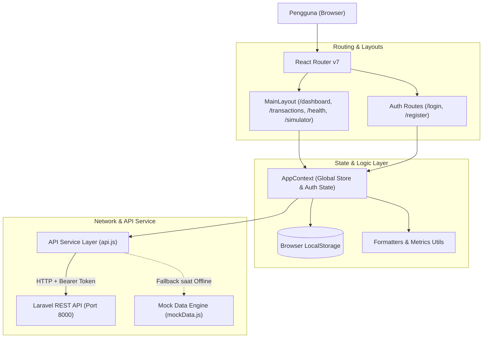

# 📋 Dokumentasi Implementasi Frontend: UMKM Financial Health Platform

Dokumen ini merangkum seluruh arsitektur, struktur kode, antarmuka pengguna, serta integrasi REST API backend pada aplikasi **BisnisCerdas (UMKM Financial Health Platform)** di branch `feature/frontend`.

---

## 📑 Daftar Isi
1. [Ringkasan Eksekutif](#1-ringkasan-eksekutif)
2. [Arsitektur Frontend & Struktur Direktori](#2-arsitektur-frontend--struktur-direktori)
3. [Layer Layanan API & State Management](#3-layer-layanan-api--state-management)
4. [Halaman & Navigasi Aplikasi](#4-halaman--navigasi-aplikasi)
5. [Komponen Antarmuka & Visualisasi Data](#5-komponen-antarmuka--visualisasi-data)
6. [Mekanisme Keandalan: Smart Fallback (Offline Mode)](#6-mekanisme-keandalan-smart-fallback-offline-mode)
7. [Panduan Menjalankan, Build & Testing](#7-panduan-menjalankan-build--testing)

---

## 1. Ringkasan Eksekutif

- **Framework & Library:** React 19 / Vite 8
- **Styling Engine:** Tailwind CSS v4 + PostCSS
- **Icon Set:** Lucide React (`lucide-react`)
- **Charting & Visualisasi:** Recharts 3
- **Routing:** React Router v7 (`react-router-dom`)
- **State Management:** React Context API (`AppContext`)
- **Target URL Port:**
  - Frontend: `http://localhost:3000`
  - Backend API: `http://localhost:8000/api`
- **Metode Deployment:** Docker Compose Container (`node:20-alpine`) & Native Vite Dev Server

---

## 2. Arsitektur Frontend & Struktur Direktori

Aplikasi dirancang dengan pendekatan modular berbasis komponen, memisahkan logika penyajian (UI), pengelolaan state global (Context), serta layer komunikasi jaringan (Service Layer).



### Struktur Direktori `frontend/src/`

```
frontend/
├── .env                         # Konfigurasi env frontend (VITE_API_URL)
├── Dockerfile                   # Docker multi-stage build (Dev & Prod)
├── package.json                 # Daftar dependencies & script
├── vite.config.js               # Konfigurasi Vite server & plugins
└── src/
    ├── assets/                  # Asset gambar & ikon statis
    ├── components/              # Komponen UI modular
    │   ├── AuthGuards.jsx       # Route Guards: ProtectedRoute & PublicRoute
    │   ├── CashflowChart.jsx    # Grafik batang arus kas masuk vs keluar (Recharts)
    │   ├── CurrencyInput.jsx    # Input angka dengan formatting otomatis Rupiah
    │   ├── HealthGauge.jsx      # Visual speedometer skor kesehatan finansial
    │   ├── StatCard.jsx         # Kartu metrik ringkasan (Saldo, Pemasukan, Pengeluaran)
    │   └── TransactionModal.jsx # Modal pencatatan kas masuk & keluar
    ├── context/
    │   └── AppContext.jsx       # Global State Provider (Auth, Kas, Transaksi, Sync)
    ├── data/
    │   └── mockData.js          # Dataset fallback demo offline
    ├── layouts/
    │   └── MainLayout.jsx       # Layout utama (Sidebar, Mobile Bar, Status Koneksi)
    ├── pages/
    │   ├── DashboardPage.jsx    # Halaman ringkasan eksekutif keuangan usaha
    │   ├── HealthPage.jsx       # Halaman diagnosis skor kesehatan & rekomendasi
    │   ├── LoginPage.jsx        # Halaman autentikasi masuk (dengan tombol demo)
    │   ├── RegisterPage.jsx     # Halaman registrasi akun & profil bisnis baru
    │   ├── SimulatorPage.jsx    # Halaman simulasi daya tahan kas (Runway)
    │   └── TransactionsPage.jsx # Halaman tabel & histori mutasi kas
    ├── services/
    │   └── api.js               # Klien HTTP Axios/Fetch terpusat ke Laravel
    ├── utils/
    │   └── formatters.js        # Utilitas format mata uang, tanggal, & metrik skor
    ├── App.jsx                  # Root router & route definition
    ├── main.jsx                 # Entrypoint aplikasi React
    └── index.css                # Konfigurasi dasar Tailwind CSS
```

---

## 3. Layer Layanan API & State Management

### 3.1 Layanan Komunikasi API (`src/services/api.js`)
Seluruh pemanggilan HTTP ke backend Laravel dipusatkan pada modul `api.js` untuk memudahkan pemeliharaan, interceptor autentikasi, serta penanganan error standar:

- **Base URL Dinamis:** Mengambil nilai dari `import.meta.env.VITE_API_URL` dengan default ke `http://localhost:8000/api`.
- **Bearer Token Otomatis:** Menambahkan header `Authorization: Bearer <token>` pada setiap request terproteksi secara otomatis jika token tersimpan di `localStorage`.
- **Katalog Endpoint yang Diintegrasikan:**
  - `login(email, password)` → `POST /api/login`
  - `register(payload)` → `POST /api/register`
  - `logout()` → `POST /api/logout` (dengan penanganan toleran kegagalan)
  - `getMe()` → `GET /api/me`
  - `getDashboard()` → `GET /api/dashboard`
  - `getTransactions(params)` → `GET /api/transactions`
  - `createTransaction(tx)` → `POST /api/transactions`
  - `deleteTransaction(id)` → `DELETE /api/transactions/{id}`
  - `getFinancialHealth()` → `GET /api/financial-health`
  - `simulateRunway(income, expense)` → `POST /api/runway/simulate`

### 3.2 State Global (`src/context/AppContext.jsx`)
Menggunakan React Context API (`useApp()`) yang membungkus seluruh aplikasi:
- **`user`**: Objek data pemilik dan profil usaha (`id`, `name`, `business_name`, `business_type`, `initial_cash_balance`).
- **`transactions`**: Kumpulan mutasi kas masuk dan keluar.
- **`isConnectedToBe`**: Flag boolean yang mendeteksi apakah aplikasi sedang aktif tersambung ke backend Laravel atau berjalan pada mode offline lokal.
- **`metrics`**: Perhitungan realtime rasio keuangan:
  - `currentCash` (Saldo kas saat ini)
  - `totalIncome` (Akumulasi kas masuk)
  - `totalExpense` (Akumulasi kas keluar)
  - `netCashflow` (Arus kas bersih)
  - `healthScore` (Skor komposit kesehatan 0–100)
- **Aksi Global:** `login()`, `register()`, `logout()`, `addTransaction()`, `deleteTransaction()`, `resetData()`.

---

## 4. Halaman & Navigasi Aplikasi

### 4.1 Proteksi Rute (Route Guards & Middleware)
Untuk menjamin keamanan alur akses aplikasi, diimplementasikan mekanisme Route Guards pada `AuthGuards.jsx`:
- **`ProtectedRoute`**: Membungkus rute privat (`/`, `/dashboard`, `/transactions`, `/health`, `/simulator`). Jika pengguna belum login (tidak memiliki token autentikasi), request akan langsung dialihkan (*redirect*) ke `/login`.
- **`PublicRoute` (Guest Only)**: Membungkus rute publik (`/login`, `/register`). Jika pengguna sudah login/terautentikasi, mereka tidak dapat mengakses halaman login/register kembali dan otomatis dialihkan ke `/dashboard`.

### 4.2 Halaman Autentikasi
1. **Login Page (`LoginPage.jsx`):**
   - Mendukung autentikasi email & kata sandi ke backend Laravel.
   - Dilengkapi tombol cepat **"Isi Otomatis"** (`budi@warungberkah.test` / `password123`) untuk mempermudah evaluasi juri/penguji.
   - Opsi cadangan **"Masuk Mode Standalone Demo"** jika server backend tidak diaktifkan.
2. **Register Page (`RegisterPage.jsx`):**
   - Pendaftaran terpadu: Data akun (nama, email, password) sekaligus profil bisnis (nama usaha, bidang usaha, saldo kas awal).

### 4.3 Halaman Dashboard & Fitur Inti
1. **Main Layout (`MainLayout.jsx`):**
   - **Sidebar Desktop (240px)** & **Mobile Bottom Bar** yang responsif.
   - **Indikator Status Database:** Badge dinamis hijau berkedip `Laravel (Port 8000)` saat online, atau abu-abu `Mode Lokal (Mock)` saat offline.
   - Tombol **Keluar Akun (Logout)** dengan invalidasi token dan redirect bersih.
2. **Dashboard (`DashboardPage.jsx`):**
   - Ringkasan metrik kas (Saldo Kas, Pemasukan, Pengeluaran, Arus Kas Bersih).
   - Grafik batang visualisasi arus kas harian.
   - Widget mini Skor Kesehatan Finansial & Estimasi Runway.
   - 5 riwayat transaksi kas terkini.
3. **Pencatatan Transaksi (`TransactionsPage.jsx`):**
   - Filter transaksi berdasarkan tipe (Semua, Kas Masuk, Kas Keluar).
   - Modal pencatatan kas baru (`TransactionModal.jsx`) dengan pemilihan kategori otomatis (operasional vs non-operasional).
   - Fitur hapus transaksi dengan konfirmasi.
4. **Diagnosis Kesehatan Finansial (`HealthPage.jsx`):**
   - Pengukur meteran speedometer skor (0-100) dengan kategori (Kritis, Waspada, Sehat, Prima).
   - 3 Rasio Utama: Rasio Operasional, Tren Arus Kas, dan Cadangan Kas.
   - Rekomendasi aksi prioritas yang dipersonalisasi sesuai kondisi riil UMKM.
5. **Simulasi Runway Kas (`SimulatorPage.jsx`):**
   - Kalkulator simulasi "what-if" ketahanan dana kas jika terjadi penurunan omzet atau kenaikan biaya mendadak.
   - Slider / input dinamis asumsi pemasukan & pengeluaran harian.

---

## 5. Komponen Antarmuka & Visualisasi Data

| Komponen | Kegunaan | Teknologi |
| :--- | :--- | :--- |
| `CashflowChart` | Menampilkan diagram perbandingan pemasukan vs pengeluaran secara kronologis | Recharts (`BarChart`, `ResponsiveContainer`) |
| `HealthGauge` | Visual indikator jarum / progress skor kesehatan bisnis | SVG dinamis & Tailwind Canvas |
| `StatCard` | Kartu ringkasan angka finansial dengan label status tren (Surplus/Defisit) | Tailwind CSS card |
| `TransactionModal`| Formulir popup pencatatan mutasi kas baru | Dialog overlay + validasi form |
| `CurrencyInput` | Input form dengan masking otomatis format mata uang Rupiah | Regex masking input |

---

## 6. Mekanisme Keandalan: Smart Fallback (Offline Mode)

Frontend dirancang dengan prinsip **Zero Failure**:
- Jika backend Laravel aktif, frontend melakukan handshake via `/api/me` dan `/api/transactions`, menampilkan data riil dari database MySQL, serta menyalakan indikator hijau **Laravel (Port 8000)**.
- Jika backend belum berjalan atau koneksi jaringan terputus, sistem secara elegan beralih (*graceful fallback*) ke data mock lokal (`INITIAL_USER` & `INITIAL_TRANSACTIONS`) tanpa menghasilkan layar blank (`White Screen of Death`).
- Status koneksi di sidebar langsung memberi tahu pengguna mode apa yang sedang aktif secara transparan.

---

## 7. Panduan Menjalankan, Build & Testing

> [!NOTE]
> Untuk panduan lengkap cara menjalankan seluruh stack aplikasi (backend + frontend + database) via Docker Compose maupun secara mandiri tanpa Docker, lihat **[Panduan Developer & Docker (development-guide.md)](development-guide.md)**.

### 7.1 Menjalankan via Docker Compose (Rekomendasi)

Dari **root folder** proyek (`bisnis-cerdas/`):
```bash
# Menjalankan seluruh stack (frontend, backend, database)
docker compose up -d --build

# Atau menjalankan frontend saja
docker compose up -d frontend
```
Aplikasi siap diakses di: **`http://localhost:3000`**

### 7.2 Menjalankan Frontend Secara Mandiri (Tanpa Docker)

Jika ingin menjalankan frontend langsung di sistem lokal tanpa Docker:

| Prasyarat | Versi Minimum | Cara Cek |
| :--- | :--- | :--- |
| Node.js | 20.x LTS | `node -v` |
| npm | 9.x+ | `npm -v` |

```bash
# 1. Masuk ke direktori frontend
cd frontend

# 2. Install dependencies
npm install

# 3. Jalankan Vite development server
npm run dev
```
Aplikasi siap diakses di: **`http://localhost:3000`**

> [!TIP]
> Frontend bisa berjalan mandiri tanpa backend aktif berkat mekanisme **Smart Fallback (Offline Mode)** — lihat [Bagian 6](#6-mekanisme-keandalan-smart-fallback-offline-mode). Namun untuk data riil dari database, pastikan backend dan MySQL sudah aktif.

### 7.3 Kompilasi Produksi (Production Build)
Untuk memastikan tidak ada kesalahan kompilasi TypeScript/JSX:
```bash
npm run build
```
Hasil build teroptimasi akan dihasilkan pada folder `frontend/dist/`.

---

## 📎 Dokumen Terkait

| Dokumen | Relevansi |
| :--- | :--- |
| **[Desain Sistem & UI (design-system.md)](design-system.md)** | Panduan palet warna, tipografi, dan komponen antarmuka yang digunakan frontend ini |
| **[API Contract (api-contract.md)](api-contract.md)** | Spesifikasi endpoint REST API yang dikonsumsi oleh Service Layer frontend |
| **[Dokumentasi Backend (backend.md)](backend.md)** | Arsitektur sisi server yang menyediakan data melalui API |
| **[Panduan Developer & Docker (development-guide.md)](development-guide.md)** | Panduan inisialisasi, Docker Compose, dan alur Pull Request |
